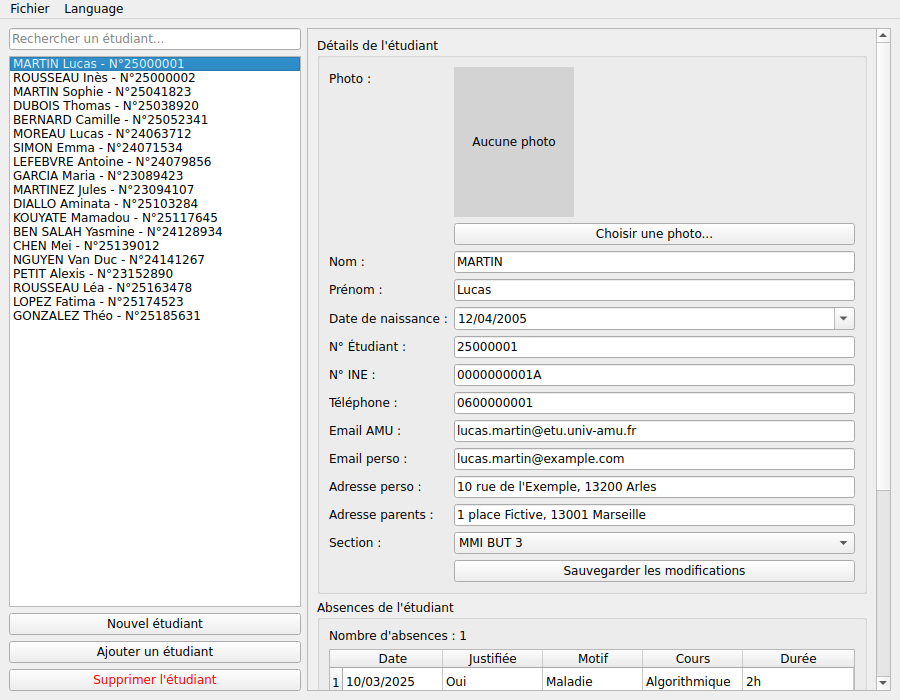

# Gestion des étudiants | SAÉ 2.01

Application de bureau en C++ et Qt 6 pour charger, consulter, modifier et enregistrer des fiches étudiantes. Projet réalisé en binôme en 1re année de BUT Informatique (IUT d'Aix-Marseille, site d'Arles), soutenu le 9 juin 2026.

**Auteurs :** Djawad TOURE ISSAHOU et Aldo Alex NGANJI



## Fonctionnalités

- Interface master / detail : liste des étudiants à gauche, fiche complète à droite (identité, coordonnées, photo, section).
- Sous-formulaire des absences (date, justification, motif) dans un `QTableWidget`.
- Lecture et écriture aux formats **JSON** (`QJsonDocument`) et **XML** (`QXmlStreamReader` / `QXmlStreamWriter`).
- « Enregistrer » et « Enregistrer sous », alerte à la fermeture en cas de modifications non sauvegardées.
- Recherche dans la liste par nom, prénom ou numéro, avec expressions régulières.
- Interface traduite en français et en anglais avec Qt Linguist.

## Répartition

| Membre | Contributions |
| --- | --- |
| Djawad TOURE ISSAHOU | Chargement XML, sauvegarde JSON et XML, Enregistrer / Enregistrer sous, alerte de fermeture (`closeEvent`), ajout et suppression d'étudiants, barre de recherche avec `QRegularExpression` |
| Aldo Alex NGANJI | Chargement JSON, formulaire détail, sous-formulaire des absences, internationalisation |

## Compiler et lancer

Prérequis : Qt 6 (qmake) et un compilateur C++17.

```bash
qmake6 GestionEtudiants.pro
make
./GestionEtudiants
```

Ouvrir ensuite `test_etudiants.json` ou `test_etudiants.xml` depuis le menu Fichier. Toutes les fiches de test sont fictives.

## Documents

- `docs/diagramme_UML_groupe18_Etudiant_IUT.pdf` : diagramme de classes
- `docs/feuille_de_temps_groupe18.csv` : feuille de temps du binôme
